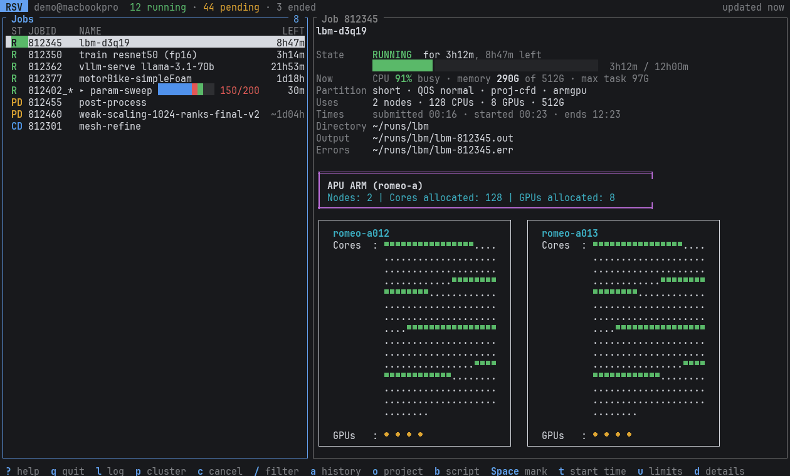

# Romeo Slurm Viewer (RSV)

Your Slurm jobs on the [ROMEO](https://romeo.univ-reims.fr/) cluster, from the terminal: where they run, how long they have left, why they wait, their logs, and what they really used.



## Install

On a ROMEO login node:

```bash
git clone https://github.com/wolf75222/RSV.git ~/RSV && ~/RSV/install.sh
```

Then run `rsv`. To update: `cd ~/RSV && git pull && ./install.sh`.

## Keys

| Key | |
|---|---|
| `↑` `↓` or `j` `k` | move (`g` `G`: first, last) |
| `l` or `Enter` | the job's log, followed as it grows (`Tab`: errors, `/` search, `e` next error) |
| `Enter` on an array | its tasks, under it (`←` folds them) |
| `b` | the script the job was submitted with |
| `d` | everything `scontrol` says about the job |
| `n` | the job's GPUs now: use and memory |
| `c` | cancel the job, or a whole array (asks first) |
| `H` | hold or release a waiting job (ROMEO refuses both to users, RSV says why) |
| `Space` | mark jobs: `c` then cancels all of them |
| `y` | copy the job id |
| `/` | filter |
| `s` | sort |
| `o` | your project: everyone's jobs in your accounts, read-only |
| `a` | the last 7 days: what each job used, CPU and GPU hours, what was wasted |
| `p` | the whole cluster, live: overview, queue, nodes, hardware |
| `t` | when would a job start? |
| `u` | your accounts: limits, fairshare, disk quotas |
| `?` | help |
| `q` | quit |

## What it does

- Lists your jobs with the time they have left, or when a pending one should start, and why it waits, in plain words.
- An array is one row with its progress (done, running, waiting, failed), its tasks under it on `Enter`: 200 tasks no longer make 200 rows.
- Shows where a job runs: its nodes, with their cores (`■`) and GPUs (`●`) in use.
- Follows the job's output live, with search and its error lines in red, and shows its last lines under the details. Paths open in VS Code (Remote-SSH) with a click.
- The script a waiting or running job was submitted with.
- Running jobs: how busy their CPUs are and their memory now, GPUs on demand. Pending ones: their priority and rank in the queue.
- History with CPU, memory and time efficiency, CPU and GPU hours, what was reserved but idle and the time asked but not used.
- Your project: your colleagues' jobs in your accounts, read-only.
- Several jobs at once: mark them, then cancel them, after a confirmation that lists them.
- The whole cluster, live: CPUs, GPUs, load, memory and storage in use with their curve since you opened it, reservations and maintenances, partitions and their rules, everyone's queue and why it waits, the nodes down and why, a map of every node (yours marked) with a zoom on one, and the hardware of each kind of node.
- When would a job start? Slurm's own estimate for the job you describe, without submitting it.
- Your accounts: their limits, fairshare and disk quotas.
- Never freezes: Slurm is asked in the background, with timeouts, and less often when it is slow. Quits when the SSH connection drops.
- Works in any terminal, over SSH too: 24-bit colors, aligned columns whatever the names, small windows.

## Docs

[Usage](docs/usage.md) · [Terminals](docs/terminals.md) · [Changes](docs/changes.md) · [Development](docs/development.md)
