# Usage

```bash
rsv                  # your jobs
rsv --refresh 30     # read the queue every 30 s (default 15, at least 5)
rsv --color 256      # truecolor, 256, 16 or auto, see terminals.md
rsv --no-mouse       # leave the mouse to the terminal, to select text
```

The same as environment variables: `RSV_REFRESH=30`, `RSV_COLOR=256`, `RSV_MOUSE=0` (in `~/.bashrc` to keep them). `RSV_VSCODE_HOST` names ROMEO in your SSH config for the links to VS Code (`romeo` by default), `RSV_LINKS=none` takes the links away (see [terminals](terminals.md)).

When `squeue` is slow, RSV reads the queue less often by itself: ten times the time `squeue` took (2 s: every 20 s), twice longer after each failure, 2 minutes at most, and back to `--refresh` when Slurm is. The top line says so (`Slurm slow: every 20 s`).

## The job list

Your jobs, running first, then pending, then the ones that just ended (Slurm forgets them after 5 minutes on ROMEO). `LEFT` is the time left of a running job, or `~` the time until a pending job should start, when Slurm has an estimate.

| Key | |
|---|---|
| `↑` `↓` `j` `k` | move |
| `PgUp` `PgDn`, `Ctrl-U` `Ctrl-D` | a page |
| `g` `G`, `Home` `End` | first, last |
| `/` | filter: type, `Enter` keeps it, `Esc` clears it. Matches the id, name, state, partition, account and pending reason |
| `s` | sort: state, newest first, name, time left |
| `J` `K` | scroll the details (or the mouse wheel over them) |
| `Space` | mark the job (or array) and go to the next one: `c` then cancels all the marked ones, `Esc` unmarks them |
| `Enter`, `→` `←` | on an array: show its tasks under it, fold them |
| `o` | the project view: everyone's jobs in your accounts, read-only (`o` again: yours) |
| `r` | refresh now |
| `q`, `Esc`, `Ctrl-C` | quit (`Esc` clears the marks or the filter first) |

The selection follows the job through refreshes and sorts.

**Arrays.** All the tasks of an array are one row, `812402_*`, with a bar of its tasks (done, failed, cancelled, running, waiting) and how many have ended out of how many. Its details say how many tasks are done, running, waiting, failed (with their exit codes), on which nodes the running ones are, why the others wait and when they should start. `Enter` shows its tasks under it, each with its own details, log and script. Slurm forgets a task 5 minutes after it ended: the older ones come from `sacct`, read once a minute.

**Hold and release on ROMEO.** ROMEO's submit plugin refuses every change of a job that doesn't give a time limit. `scontrol hold`, `uhold` and `release` give none: they are all refused with "Requested time limit is invalid", and `H` says so. A hold does go through with one (`scontrol update jobid=<id> TimeLimit=<its limit> Priority=0`), but then nothing lets a user release the job: `scontrol release` is refused the same way, and a user can't raise a priority. RSV doesn't hold jobs that way. A job submitted with `--hold` can only be released by the support team: cancel it and submit it again. (Tried on two test jobs, October 2026.)

**Project.** `o` shows the jobs of everyone in your accounts (those that can run jobs, from `sacctmgr`), with a `USER` column: ROMEO lets every user see the queue (`PrivateData = none`). Read-only: nothing can be cancelled or held there. The details and the logs work when the files can be read.

## The details

State, time used and left, partition, QOS and account, what the job uses (or asks for), its times, directory and output files. For a pending job: the reason in plain words, what to do about it, and the expected start.

Then its nodes, grouped by kind (`APU ARM (romeo-a)`, `APU Compute (romeo-c)`), one cell per node: `■` the job's cores and `.` the others, 20 per line, `●` the job's GPUs and `○` the others. The cores are those Slurm gave on that node (`scontrol show job -dd`), so their placement shows: 16 cores on each of the 4 sockets of a Grace node look like 4 runs of 16.

Under it, when there is room, the last lines of the job's output.

## Views

| Key | View | |
|---|---|---|
| `l`, `Enter` | Log | The output file, followed as it grows. `j` `k` `g` `G` scroll, `f` follow or pause, `←` `→` sideways, `Tab` output or errors, `y` copy the path. `/` search (`n` `N` next and previous), error lines in red (`e` `E` next and previous error). Only the last 2 MB of a big file are read. |
| `b` | Script | The script the job was submitted with (`scontrol write batch_script`), `#SBATCH` lines highlighted, `y` copies it. Slurm keeps it while the job waits or runs: ROMEO doesn't store the scripts of ended jobs (`AccountingStoreFlags` has no `job_script`). |
| `d` | scontrol | Everything Slurm says about the job, the important fields highlighted. |
| `c` | Cancel | The marked jobs, or the selected one, listed first (`y` to cancel, anything else keeps them). On an array's row, all its tasks; on `812402_[159-200]`, only the tasks still waiting when you confirm (`scancel --state=PENDING`). |
| `H` | Hold | Holds the waiting jobs (they keep waiting but don't start), or releases them when they are all held already (`scontrol hold`, `release`). For an array, its tasks still waiting when you confirm. A running job can't be paused by its user. **ROMEO refuses both** (see below). |
| `a` | History | Your jobs of the last 7 days (`sacct`), what they used, see below. `←` `→` filter by state, `s` sort, `r` read again. |
| `p` | Cluster | All of ROMEO, read again every 15 s while open, in four tabs: `←` `→` (or `Tab`, `1` to `4`) change tabs everywhere in it. See below. |
| `t` | Start time | When would a job start? Account, partition, constraint, nodes, cores, GPUs, memory and time: `Enter` asks Slurm (`sbatch --test-only`, nothing is submitted) and shows when and where, or why it can't. |
| `m` | Live | A running job live: its CPUs, memory, disk, steps and GPUs, as an overview or as a task manager's. See [the live view](#the-live-view). |
| `n` | GPUs | The job's GPUs in depth: who uses each, why one is slow (the third tab of `m`). |
| `i` | Model server | The server of models the job runs, found on its own: tokens, requests, latencies, caches (the fourth tab of `m`). |
| `u` | Limits | For each of your accounts: its CPU, GPU and job limits and what your jobs use now (`sacctmgr`, `squeue`), its fairshare and the CPU-hours used (`sshare`), then your disk quotas and your projects' (`mmlsquota`), with a warning when one is over. |
| `?` | Help | |

`y` copies the job id, `Y` its output path (see [terminals](terminals.md) for how copying works over SSH).

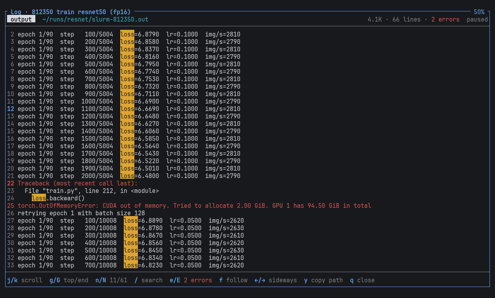

## The live view

`m` on a running job, `n` straight to its GPUs, `i` straight to its server of models. Four tabs: `1` `2` `3` `4`, `Tab` or `←` `→` (`h` `l`); `3` only when the job has GPUs, `4` only when it runs a server of models. The key that opened it closes it (`m` from the first two tabs, `n` from the GPUs, `i` from the server; each goes to its tab otherwise), as do `q` and `Esc`.

Everywhere in it: `+` `-` zoom in time (1 to 30 s per column, up to the last hour), `r` reads again. Nothing more runs once it is closed: its Slurm steps end with it.

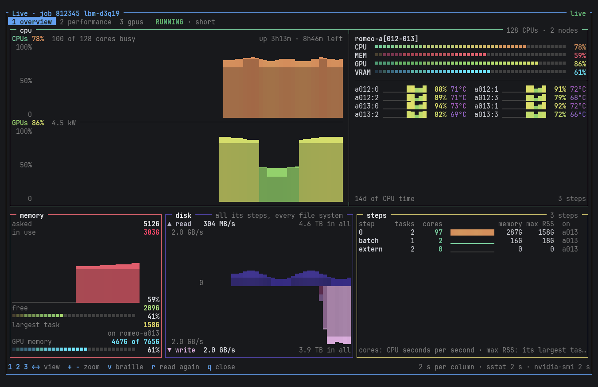

### 1 overview

Laid out as btop's boxes: muted frames, each title on its border with its number (`¹cpu`, `²mem`, `³io`, `⁴steps`), the keys that act on a box on its border too (`- 2s per column +`, `v`, `↑↓ select`, `Enter details`).

- `cpu`: the CPUs' graph and under it the GPUs' (each GPU its own graph, side by side with its name and use, when each gets 10 columns; the memory's without GPUs), with their scale. Beside them, in a box of its own named after the nodes, a meter for the CPUs, memory, GPUs and their memory, and each GPU with its little graph (braille, coloured by its value), use and temperature (each step when there is no GPU).
- `mem`: asked; used with its graph; free, the largest task and its node, GPU memory with their meters.
- `io`: the bytes its steps read per second rising, those they write hanging under them, each on its own scale written in its corner; beside them, for each, its rate, its top and its total (as btop's network box).
- `steps`: as btop's processes, the busiest first: each step with what it runs (its name in `squeue -s`: `python`, `lbm3d`...), its tasks, the cores it keeps busy and their little graph, its memory and largest task. `↑` `↓` pick one, `Enter` shows it in depth above the list (its graph of cores, what it runs, tasks, memory, largest task and its node, reads and writes per second and in all), `Esc` back.

The graphs are solid areas, each column in the colour of its value, its top to an eighth of a character. `v` draws them as btop does instead: braille (or blocks), two readings per character, a dot at least where there is one, each row coloured along the gradient by its height (btop's `Draw::Graph`, the same tables of characters).

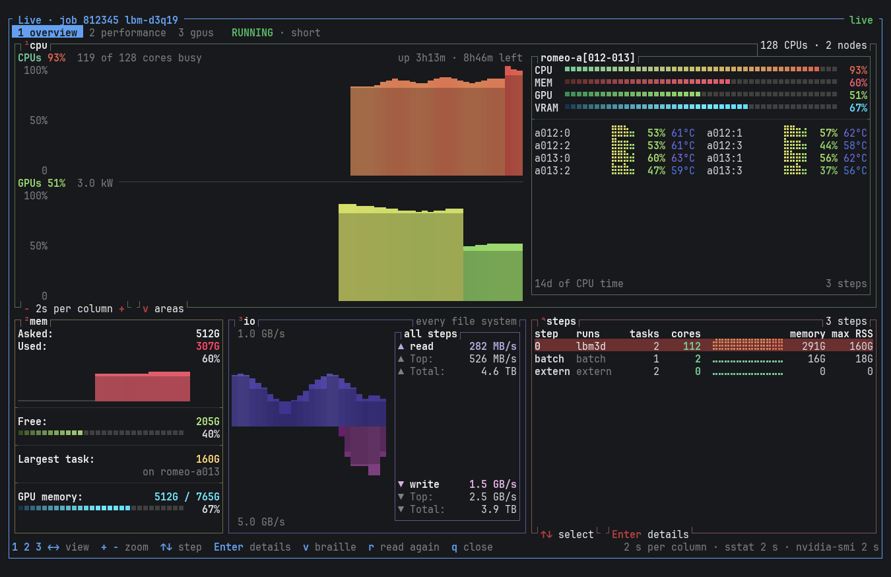

### 2 performance

As a task manager's: CPU, memory, disk, all the GPUs and each one on the left with their little curves, the one picked (`↑` `↓`) on the right with its chart, its scale and time, and its figures.

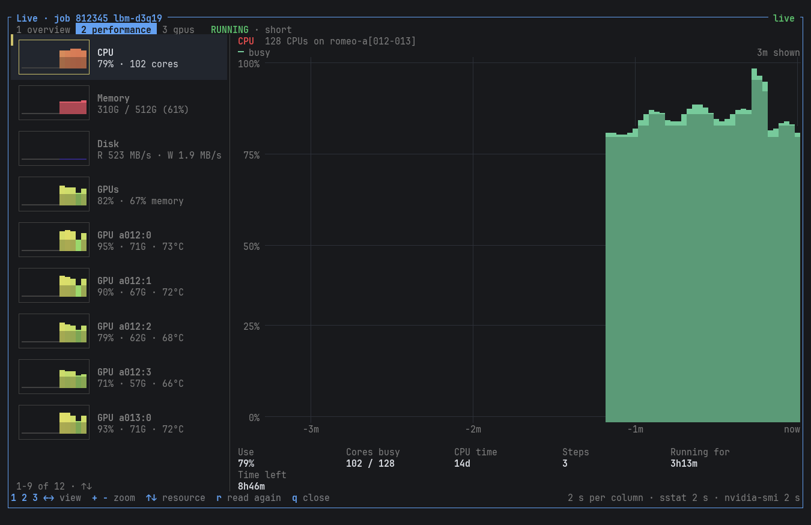

### 3 GPUs (`n`)

On the left, grouped by node, each GPU with its curve, use, SM activity, memory, temperature, power and how many processes run on it, `!` when something is wrong. On the right, the one picked (`↑` `↓`, `Enter` for it alone, `Esc` back):

- What is wrong: no process on it (reserved for nothing); slowed down by its power cap or its temperature; busy but on few SMs; uncorrected memory errors, memory rows to remap.
- Its curves: busy, SM activity and occupancy, tensor cores; memory in use and DRAM activity; PCIe/C2C and NVLink traffic.
- Its clocks against their maximum, power against its limit, ECC errors, and its processes with their Slurm step and rank.

SM, tensor, DRAM and link figures come from Hopper's GPM counters (`nvidia-smi dmon --gpm-metrics`), what DCGM would give; the first two readings have none. A job that already uses all the processes it may (8192 on ROMEO, a vLLM with Ray can) can't start `dmon`: the view says so and shows the rest.

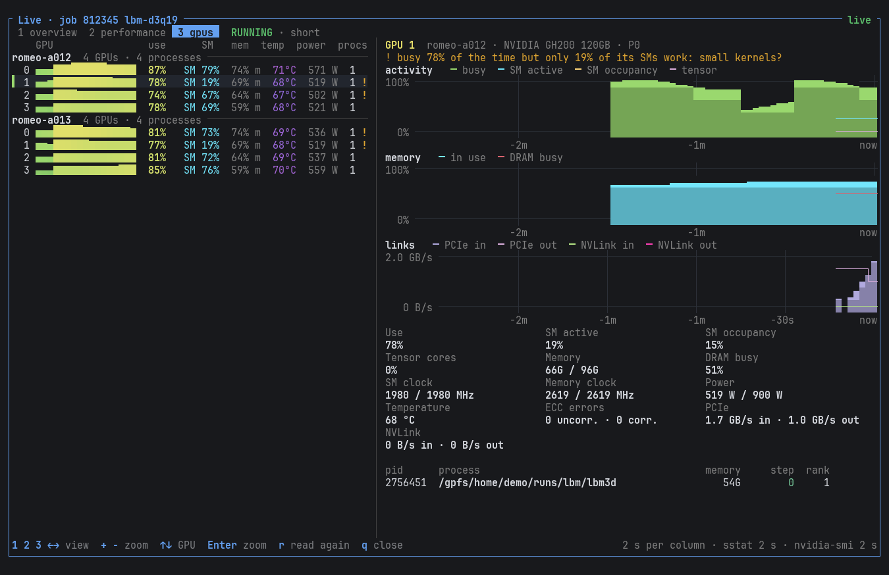

### 4 inference (`i`)

The server of models the job runs: vLLM, SGLang, TGI, llama.cpp, Triton (and TensorRT-LLM) or Ollama, found without being told. RSV reads the job's output, errors and script for the engine and where it listens (`Uvicorn running on http://0.0.0.0:8000`, `--port 8000`), then asks each place for its Prometheus metrics (`GET /metrics` on the job's nodes, from the login node: nothing runs in the job). Each engine names its metrics its own way: RSV reads them all as the same figures, and leaves out what an engine doesn't give. The tab shows only when a server was found (or `i` was pressed).

- At the top: the engine, the model, its address, the requests and tokens since it started.
- What is wrong, when something is: requests preempted (the KV cache was full: their work is done again); requests waiting for 10 s or more; the KV cache over 90%; requests aborted; GPUs busy but no token (loading, compiling); few drafted tokens accepted; the KV cache under 5% for minutes with never a queue (it could serve many more requests at once, or run on fewer GPUs); no request for 5 minutes; most of the prompt from the prefix cache (long shared contexts: an agent).
- A tile for each figure, with its curve: tokens generated and read per second, requests running and waiting, KV cache, prefix cache hits, time to the first token (p50), time per token.
- Charts: the tokens generated per second (alone: an agent's prompt tokens, mostly cached, can be a thousand times more), the time to the first token (p50, p95).
- `latency`: over the last minute, p50, p95 and mean of the first token, each token, the whole request, its queue, prefill and decode; where a request's time goes; the requests by how long they took.
- `cache & drafts`: the KV cache and its peak, the prefix cache hits, preemptions, and speculative decoding: the share of drafted tokens kept, tokens per step, at each position of a draft.
- `requests`: how many ended and how (stop, length, abort, error), per minute, their average prompt and answer, and the GPUs' use beside the tokens over the last 5 minutes.

Rates are over the last 10 s, latencies and cache hits over the last 30 s (from the histograms and counters then and 30 s before): they follow what the server does now. Several servers in one job: `↑` `↓`. None answering yet (a model still loading): what was read and asked, looked at again every 15 s, `r` now. Another server, or one RSV doesn't find: `RSV_METRICS_URL=http://{node}:8000/metrics rsv` (`{node}`: each of the job's nodes; several with commas).

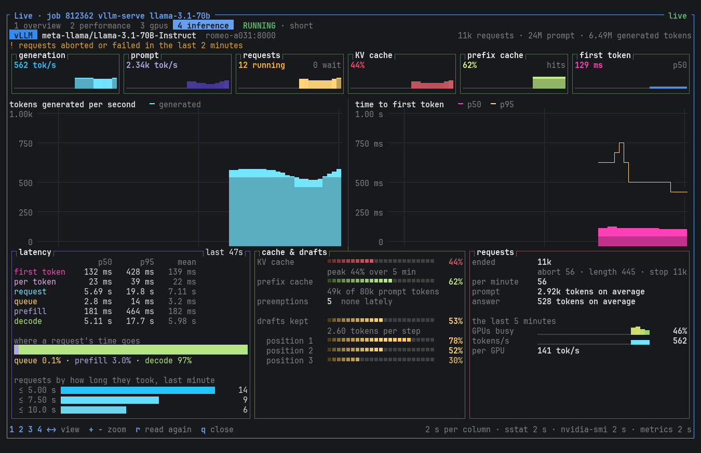

## Cluster tabs

- **Overview**: jobs and users, CPUs and GPUs in use and asked for by pending jobs, with their curve since the view was opened (one point per refresh, its lowest and highest value), the load (reserved cores really busy, nodes reserved but idle), memory, storage (`/gpfs`), nodes, Slurm's controller and scheduler cycles (`sdiag`); reservations and maintenances to come (a job still running when one starts waits); partitions with their time limit, priority tier and rules; kinds of nodes (armgpu, x64cpu).
- **Queue**: everyone's jobs by partition, why the pending ones wait with what they ask for (`Resources`: the cluster is full for them, `Priority`: others go first), the users with the most CPUs (`a`: by account).
- **Nodes**: the nodes down or drained, since when, by whom and why (`sinfo -R`), then every node: a map (`■` busy, `■` yellow reserved but idle, `.` free, `●` GPU in use, `x` down, your jobs' nodes inverted), or a table with its load, memory and note (`t`). `↑` `↓` move a cursor from node to node (`PgUp` `PgDn` a row of the map, `g` `G` the first and last), `Enter` zooms on the node: its state and why it is down (by whom, since when), CPUs reserved and busy, memory reserved and free, GPUs in use, and its jobs (`squeue -w`: user, CPUs and GPUs, nodes, since when, time left). In the zoom `n` `N` go to the next and previous node, `j` `k` scroll its jobs, `Esc` back to the map.
- **Hardware**: each kind of node: how many and which, CPU model with sockets × cores, arch, memory per node and for jobs, GPUs with their model and memory, local disk, partitions. Slurm doesn't know the CPU and GPU models: they come from a small table of ROMEO's hardware (AMD EPYC 9654, NVIDIA GH200).

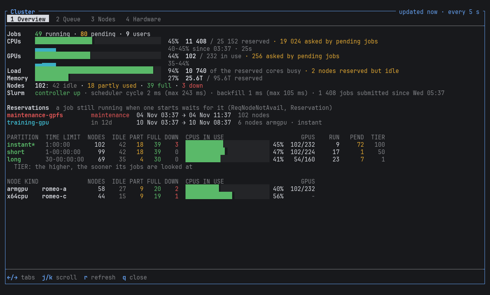

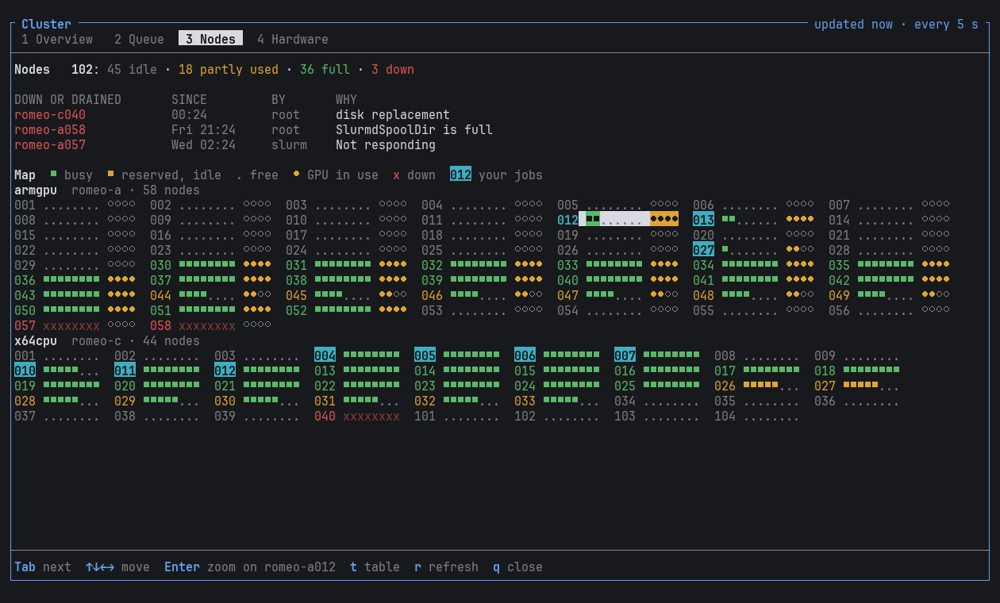

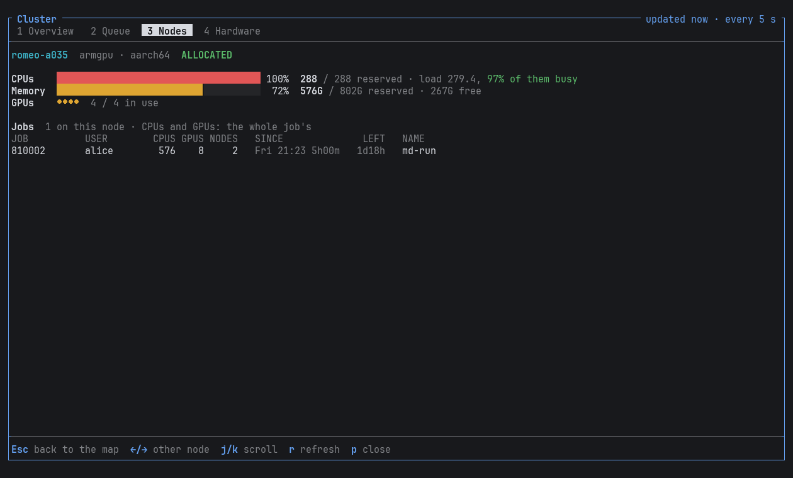

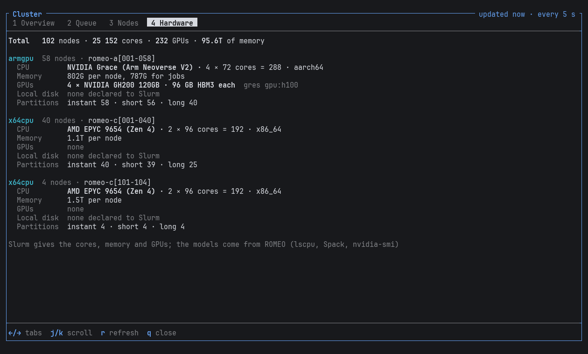

## In the details

- A running job: `Now` is how busy its CPUs were between the last two readings (`sstat`, CPU time over time × CPUs: the first reading counts since the job started), and the memory of its running steps.
- A pending job: its priority, its rank among the jobs waiting in its partition, and what the priority is made of (`sprio`).

## History columns

- `CPU`: CPU time used / CPU time allocated (`TotalCPU / CPUTimeRAW`). 50% on 64 cores: half of them waited.
- `MEM`: the largest memory used by a task (`MaxRSS`, over all steps) / the memory per node. A rough measure for multi-task jobs: Slurm only keeps the largest task.
- `TIME`: run time / time limit. Asking for 12 h and using 1 h makes the job wait longer: backfill can only start a short job in a gap.

The line under the table says what the selected job used and, when it applies, what to change.

Above the table, what the jobs of the last 7 days used: CPU hours reserved, used and idle (the idle share, and how much of it in GPU jobs), GPU hours, and the time asked with `--time` that completed jobs didn't use. `CPU-H` and `GPU-H` columns when the window is wide enough, `s` sorts by the most idle CPU hours. A running job's CPU time is only known once its steps end: running jobs are left out of the totals. Slurm doesn't record how busy GPUs were on ROMEO: only the GPU hours reserved.

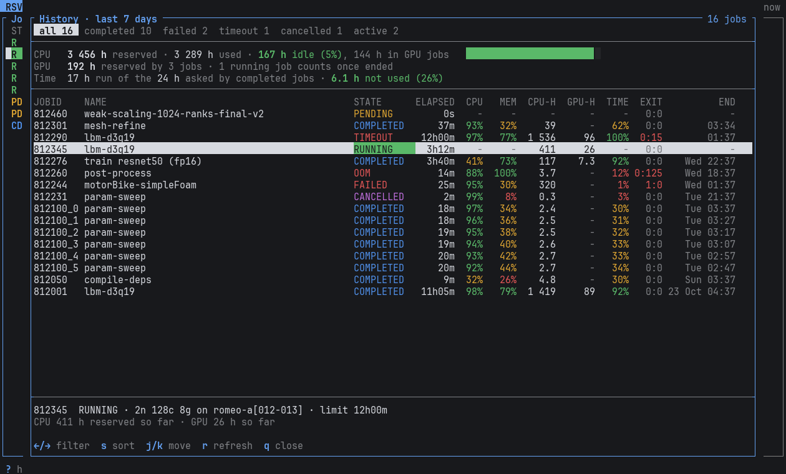

## Where the data comes from

| | Command | When |
|---|---|---|
| Jobs | `squeue -u $USER -t all -O ...` (`-A <accounts>` in the project view) | every 15 s, less often when Slurm is slow |
| Arrays | `sacct -X -j <arrays> -o JobID,State,ExitCode` | once a minute, and when a new array shows up |
| Script | `scontrol write batch_script <job> -` | on `b` |
| Details, nodes | `scontrol show job -dd`, `scontrol -o show node` | for the selected job |
| Live use, priority | `sstat -a -j <job>`, `sprio` | for the selected job |
| History | `sacct -u $USER -S now-7days -P` | when opened, at most once a minute |
| Cluster | `sinfo -N -O ...`, `squeue -t R,PD,CG -O ...` (everyone's jobs), `sinfo -R`, `scontrol show reservation`, `scontrol ping`, `statvfs(/gpfs)` | every 15 s while open |
| Cluster, at opening | `sdiag`, `scontrol show partition` | when opened |
| Hardware | `scontrol -o show node` | when its tab is first shown |
| Node zoom | `scontrol -d -o show node <node>`, `squeue -w <node>` | on `Enter`, then every refresh |
| Start time | `sbatch --test-only` | on `Enter` |
| Model server | finding it: the job's output and errors (their first 2 MB and last 512 KB), `scontrol write batch_script <job> -`, then `curl http://<node>:<port>/metrics` on each place they name (Ollama: `/api/ps`); reading it: `curl` its metrics | found when the live view opens (again every 15 s while it runs one that doesn't answer yet, every 2 min if not), read every 2 s while the view is open |
| Live | `sstat -a -j <job>` (each step: CPU time, memory, bytes read and written, largest task and its node), `srun --jobid=<job> --overlap nvidia-smi --loop-ms=2000` (one step) | every 2 s while open |
| GPUs, in depth | `srun --overlap` steps named `rsv-live-*`: `nvidia-smi dmon --gpm-metrics ... -d 2`, `nvidia-smi --query-compute-apps=... --loop-ms=5000`, `scontrol listpids` on each node and `nvidia-smi --query-remapped-rows` (when opened, and when a new process shows up, at most every 30 s); `squeue -s` to leave the view's own steps out of the job's | while the GPU view is open |
| Limits | `sacctmgr show assoc`, `sshare -U`, `mmlsquota -Y` | when opened |
| Cancel, hold | `scancel <ids>`, `scontrol hold <ids>`, `scontrol release <ids>` | when confirmed |

Every command runs in the background with a time limit (15 s, 30 s for `sacct`): when Slurm is slow, RSV keeps the last answer on screen and says what failed in its top line.
